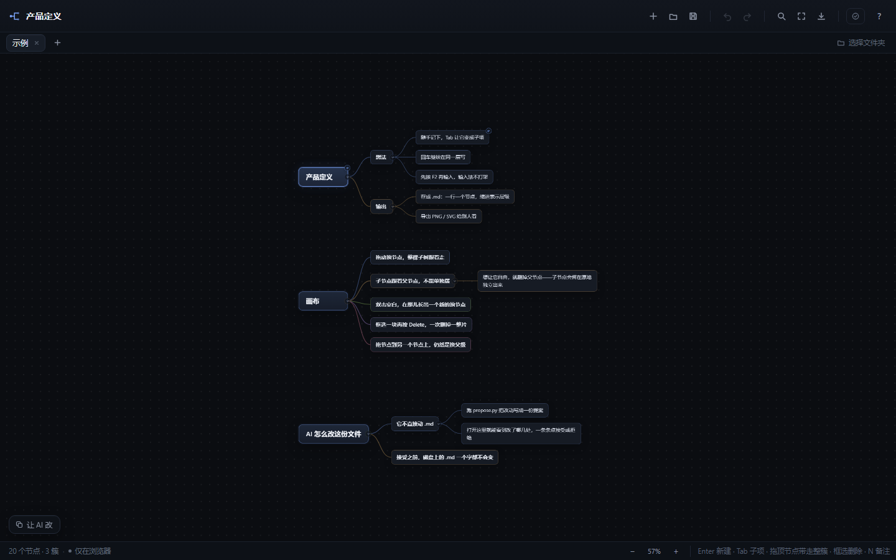

# Mind · 树形思维（产品定义）

一个给「把想法理成树」用的小工具。不是白板，没有卡片墙和模板库：**一行一个节点，两空格一级**。
没有依赖、没有构建步骤，存档就是一份 Markdown。Windows 和 macOS 都能跑。

一个窗口里开多个文档，一个标签就是磁盘上的一个 `.md`。

画布上没有唯一的中心。每个顶层节点就是一块自己的簇，摆在它自己的位置上；拖它，整簇跟着走。



## 启动

Windows 和 macOS 都有双击入口。它起一个只监听本机的服务，再把浏览器打开。
那个终端窗口就是开关：关掉它服务就停。已经在跑的时候再双击，只会把浏览器切过去，
不会再开一个。

### Windows

**双击 `产品定义.cmd`。**

端口默认 8765；被别的程序占着会直接说出来，想换：`产品定义.cmd -Port 8766`
（`mind.ps1` 开头也能改默认值）。

### macOS

**双击 `Mind.command`。**

- 第一次如果被 Gatekeeper 拦住：右键 →「打开」，或者在终端执行一次
  `chmod +x Mind.command`。
- 如果双击后是文本编辑器打开：说明可执行位丢了，先 `chmod +x Mind.command`。
- 需要 Python 3.9 以上。macOS 第一次运行 `python3` 会提示安装 Command Line Tools；
  也可以 `brew install python`。
- 换端口：`./Mind.command 8766`。
- 想绑定工作文件夹、按 `⌘S` 原地写回 `.md`，用 **Chrome 或 Edge**。Safari 不支持
  File System Access，保存会退化成下载文件（功能不丢，只是多一步）。
- 第一次让「让 AI 改」去找文件时，macOS 可能会问终端能不能访问「文稿 / 桌面 / 下载」。
  允许它，`/api/find` 才能按文件名 + 树指纹找到 `.md`；拒绝也能用，手填一次绝对路径即可。

手动起也行，在工具目录：

```bash
# macOS / Linux
python3 server.py 8765 --bind 127.0.0.1 --directory .

# Windows
python server.py 8765 --bind 127.0.0.1 --directory .
```

用老的 `python -m http.server …` 也能看，但它只有 GET：审批完的提案清不出
`proposals/`，换浏览器会把已经生效的提案再弹一遍（下面「审批完自动清」）。

打开 <http://127.0.0.1:8765/>。

也可以直接双击 `index.html`（`file://` 打开）。两种方式功能一样，审批在两种下都会自己冒出来；
只是 `file://` 下浏览器的文件系统 API 会被拦，保存会退化成下载 `.md` 文件——所以才要那个小服务。

第一次打开自带一棵示例树。点标签栏的 `+`（或 `Alt+N`）开新标签，回车直接写。

**想让新标签一建就在磁盘上**：点右上角的「选择文件夹」绑定一个工作文件夹。之后每个新标签
都会立刻在文件夹里建出 `<名字>.md`，`Ctrl+S` 原地写，改标签名连文件名一起改。没绑定文件夹
也不影响用，只是新文档先待在浏览器里，`Ctrl+S` 时再问位置。

## 它是什么

- **一个窗口，多个文档**：标签栏切换，每份文档有自己的树、撤销栈、视口位置和备注侧栏，
  互不干扰；关掉窗口再打开，标签原样回来。
- **一片森林，不是一棵树**：没有那个必须存在的根节点。想开一块新话题，双击空白处就长一个，
  各块自己占地方，不用为了新想法把整棵树挤一遍。
- **簇内是结构，簇间是位置**：只有顶层节点记坐标，子节点跟着父节点走。
  所以拖动顶层节点是搬家，拖动子节点只是换父级。
- **删除不会连坐**：删掉一个节点，它的子节点升一级、留在原地，不会跟着消失。
  真想一次删一片，框选再按 `Delete`。
- **键盘优先**：回车长同级，Tab 长下级，Shift+Tab 提升，Alt+↑↓ 同级挪位。
- **中文输入法安全**：编辑时文字进原生 `textarea`，不会在组词过程中抢按键。
- **每个节点都能带备注**：长段落随意写，按 `N` 打开侧栏；备注跟大纲一起存，不丢。
- **自动落盘**：绑定工作文件夹后新标签直接建文件；没绑定则每次改动先写 `localStorage`，
  关掉页面再打开能恢复。
- **文件是 Markdown**：`.md` 就是嵌套列表，可以直接发给 AI 讨论、丢进任何编辑器、
  在 GitHub / Obsidian 里预览，也能被 diff 和脚本处理。
- **AI 的改动要人点头**：AI 不碰 `.md`，它跑 `propose.py` 写一份提案。打开文档时改动会铺在
  画布上，一条条接受或拒绝。人没点接受，磁盘上的文件一个字都不变。

## 操作

> 下表写的是 Windows 的 `Ctrl` / `Alt`；macOS 上分别是 `⌘` / `Option`。
> 打开页面后，工具栏和帮助层里的提示会自动换成当前平台的写法。

### 结构

| 键 | 动作 |
| --- | --- |
| `Enter` | 新建同级，并直接进入输入 |
| `Tab` | 新建子项，并直接进入输入 |
| `Shift+Tab` | 提升一级（已经顶层的就独立成一块） |
| `Ctrl+]` / `Ctrl+[` | 缩进到上一个同级下面 / 提升一级 |
| `Ctrl+Enter` | 新建子项（同 Tab） |
| `Alt+↑` / `Alt+↓` | 在同一层里挪位置 |
| `Delete` / `Backspace` | 删掉这个节点，**子节点升一级留在原地**；选中多个就一起删 |
| `Space` | 折叠 / 展开 |
| `C` | 蓝图注释框：选中节点就框住它们（标题直接进入编辑）；空地按 C，在鼠标处长一个空框 |
| `F` | 适应画布 |

### 走位与编辑

| 键 | 动作 |
| --- | --- |
| `↑` / `↓` | 上一个 / 下一个可见节点 |
| `←` | 已展开则折叠，否则回到父级 |
| `→` | 已折叠则展开，否则进入第一个子项 |
| `Home` / `End` | 第一个 / 最后一个 |
| `Shift` + 点 | 加选 / 取消选中 |
| `Esc` | 取消多选 / 完成编辑 / 收起备注 |
| `F2` 或双击 | 编辑文字 |
| `N` | 打开 / 收起备注侧栏（跟随当前选中节点） |
| `Ctrl+Z` / `Ctrl+Shift+Z` | 撤销 / 重做 |

### 备注

选中节点按 `N`，或点节点右上角的小圆点。侧栏是一个不限长度的文本框：换行、空行、
几百字都行，边打边自动保存。侧栏跟着选中走——按 `↑`/`↓` 换节点就是换备注。

- 有备注的节点右上角常驻一个小圆点；没有的只在悬停时露出来。
- 备注参与搜索（`Ctrl+F` 能搜到备注里的字）。
- 备注内容长度不影响节点大小，画布不会被撑乱。
- 空备注等于没有备注；清空后圆点会自己消失。
- **侧栏左边缘可以拖动调宽**（280–760px）。本次会话内记住：刷新还在，关掉标签页恢复默认。
  审批面板用的是同一个把手（在它右边缘），两块面板会互相让位：一块拉宽，另一块到上限就收住。

**代码块**：点侧栏底部的「代码块」，选 **JSON / TypeScript / Rust**，会插入一个空块，
把代码粘进去就行。

````text
坐标系约定：右手系，Y 轴向上。

```rust
#[derive(Clone, Copy)]
pub struct Vec3 { pub x: f32, pub y: f32, pub z: f32 }
```
````

- 只支持这三门语言，其他语言按纯文本显示——不做自动猜测，猜错过一次就够了。
- 高亮是**实时**的：关键字、类型、函数、字符串、数字、注释、标点各有颜色，整段都是彩的。
- 底层仍是标准围栏，手动在文本里写 ```json 也一样；一个备注里可以放多个块。
- 中文输入法组字时，高亮层会让位给真实文字，不会出现「看不见正在打的字」。

### 鼠标

| 操作 | 动作 |
| --- | --- |
| 拖**顶层**节点 | 整簇跟着走（子节点一起） |
| 拖**子**节点 | 不自由移动，只能拖到别的节点上换父级；松在空白处会滑回去 |
| 拖空白 | 框选节点；框住整个注释框或框过它的标题栏，也会选中注释框 |
| `Shift` + 框选 | 在已有选中上追加 |
| 双击空白 | 在那儿新建一个顶层节点，并直接进入输入 |
| 中键 / 右键拖 | 平移画布 |
| `Ctrl`+滚轮 | 以指针为中心缩放 |
| 滚轮 | 上下平移 |
| 点节点右侧小圆点 | 折叠 / 展开 |
| `Alt` + 点连线 | 剪断：子节点带着整棵子树独立成块，停在原来画着的位置（按住 Alt 时连线亮红提示，进撤销栈） |
| 拖注释框（标题或框体） | 注释框带着**根节点在框里的簇**一起走；右下角拖角拉伸（只改框，不动节点） |
| 点注释框色点 | 弹出色板换颜色；选中注释框按 `Delete` 删框——节点原地全留 |
| 双击注释框 | 改名（选中注释框按 `F2` 也行） |

拖进自己的子树会被拒绝；拖到空白处松手 = 取消，节点滑回原位。目标不在视野里时先按 `F` 缩小。
也可以把 `.md` / `.txt` 文件直接拖进窗口打开。

### 文件

| 键 | 动作 |
| --- | --- |
| `Ctrl+S` | 保存（有文件就原地写，没有则弹出保存/下载） |
| `Ctrl+Shift+S` | 另存为 |
| `Alt+O` | 打开（可多选，每个文件一个标签，已经开着的会直接跳过去） |
| `Alt+N` | 新建标签 |
| `Alt+A` | 打开左下角那个「让 AI 改」（再点一下胶囊就收起） |
| `Ctrl+F` | 搜索，`Enter` / `Shift+Enter` 跳下一个 / 上一个 |

`Ctrl+O` / `Ctrl+N` 也接了，但浏览器可能先一步抢走（Chrome 里 `Ctrl+N` 是开新窗口），
所以工具栏按钮和上面的 Alt 组合才是可靠入口。

### 标签

| 操作 | 动作 |
| --- | --- |
| 点标签 | 切过去（各自的树、撤销栈、视口、备注面板都记着） |
| 双击标签 | 改名；磁盘上的文件一起改 |
| 标签右侧 `×` / 中键点标签 | 关闭；有没保存的改动会先问 |
| `Alt`+`1`…`9` | 跳到第 n 个标签 |
| `Ctrl+Alt`+`←` / `→` | 前后切换（`Ctrl+Tab` 属于浏览器，抢不过来） |
| 右上角文件夹 | 绑定工作文件夹 / 重新授权 / 检查待审批 / 解除绑定 |

- 有改动的标签左边会出现一个琥珀色小点，存在磁盘上之后再消失。
- 状态栏说「仅在浏览器」= 这份文档还没写成文件。
- 解除文件夹绑定不会动磁盘上的文件，只是之后新建的标签不再自动建文件。
- 标签全关掉也没关系，会自动留一个空白标签。

## `.md` 格式

存档就是一份普通的 Markdown 嵌套列表：每个节点一行 `- `，两空格一级；节点的备注是挂在
它下面的引用块（`>` 开头，可以有很多行），代码块则是引用块下面真正的 fenced block。

```markdown
- 产品定义 <!--@-120,-40-->
  > 每个节点都能带一段备注
  - 想法
    - 随手记下，Tab 让它变成子项
      > 备注里可以直接放代码
      ```rust
      pub struct Vec3 { pub x: f32 }
      ```
    - 回车继续在同一层写
- 另一块 <!--@520,-40-->
  - 它自己的一簇
```

**顶层节点行尾的 `<!--@x,y-->` 是它摆在画布上的位置**。写成 HTML 注释是有意的：

- 在任何 Markdown 渲染器里都看不见，不影响观感；
- 一眼就能看出是机器写的坐标，AI 读文件时会直接忽略，也不会把它当成内容；
- 只有顶层节点有，子节点的位置永远由父节点算出来——所以复制一行到别处，不会带着一堆坐标。

没有坐标的老文件照样能开：几块会从上往下依次排开，第一次保存时补上坐标。

**蓝图注释框**不是孤儿标注：`<!--@comment:x,y,w,h,#颜色,标题-->` 整行写在它**框住的第一个簇的上面**，行尾带 `｜框: 名字、名字` 的归属清单（簇的根节点中心落在框内就算被框住，存档时现算）。它不是节点——不进大纲、不进指纹，AI 和 propose.py 直接无视那行的位置语义，但能从清单里读出这块框住了什么。任何 Markdown 渲染器里都不可见。手工删掉这一行，画布上那个框就没了，节点一个不少。

代码块的围栏行**不带 `>`**、代码行原样缩进，这样任何 Markdown 渲染器（Obsidian、GitHub、
Typora）都会把它当成「列表项里的代码块」：有语法高亮、能折叠、能直接复制去跑。如果套上
`> `，它就会被当成引用段落，代码高亮全丢——这也是为什么代码块和散文备注用两套前缀。

渲染出来就是一棵嵌套列表，发给 AI、贴进文档、在编辑器里预览都是这个结构，不会因为缩进
被软换行吞掉而塌成一坨。

读取很宽松，下面几种写法都能打开：

- 没有 `- ` 前缀的裸缩进（以前存成 `.mind` 的 Tab 存档照常读）；
- Tab 或 2 / 4 空格缩进，按最小的正缩进推断「一级」有多宽；
- `* ` / `+ ` 列表符号；
- 代码块用 ``` 或 ~~~ 围，围栏长短随你（代码里含 ``` 时用四个反引号包）；
- 围栏忘了闭合时，遇到比它更靠左的行会自动收口，不会把后面的节点吃掉。

节点文字本身以 `- ` 或 `>` 开头也不用转义：保存时每行前面都有 `- `，解析只吃掉第一个
列表符号，剩下的原样保留。文件开头没有节点可挂的 `>` 会当成普通节点。

多个顶层节点是正常的，不再被强行收进一个以文件名命名的根里。

## AI 改这份文件

AI 不改 `.md`。它改的是「提案」，人点头之后才落到文件里。

> macOS 上把下文的 `python` 换成 `python3`；左下角「让 AI 改」复制出的提示词
> 会自动用对当前平台的那一个。

### 0. 左下角那个「让 AI 改」

画布左下角有一个小胶囊。点一下摊开成卡片，写一句你要 AI 做的事，按 `Ctrl+Enter`
（或点「复制给 AI」），剪贴板里就多了一整段委托，卡片随即自己收起——像真的发出去了。
再点一下胶囊就是收起 / 摊开，`Esc` 也收，`Alt`+`A` 随时打开。

提示词里两条路径都是**绝对路径**，没有「按文件名找一下」这种话：

- 目标文件：`C:\…\产品定义.md`（macOS 上是 `/Users/…/产品定义.md`）
- 提案程序：`C:\…\tools\mind\propose.py`（macOS 上是 `/Users/…/tools/mind/propose.py`）

浏览器拿不到路径（文件句柄只给名字），所以页面回头问本地服务：先按文件名筛一遍，
再用树指纹确认——指纹是 `propose.py` 和画布两边各算一次的同一个数，对上的才是同一个
文件，不是同名文件。服务也认不出来的时候，点那行路径自己填一次，记住，以后不用再填。

复制之前会先存盘（有改动的话）：AI 读的是磁盘上的文件，两边必须是同一棵树。

剪贴板被别的东西覆盖了？再点开胶囊，按 `Ctrl+Z`（或点右下角的「↩ 放回」），刚才那段话
原样回来。这段撤销是自己实现的：用脚本清空 `textarea` 会把浏览器自己的撤销栈一起抹掉。

按钮叫「复制给 AI」而不是「发送」，是因为这里没有内置 Agent，也不打算有：它只负责把
上下文交代完整，改还是外面那些真正能动文件的 AI 去改。

### 1. 让 AI 看清现在有什么

```powershell
python propose.py tree 产品定义.md
```

```
1      产品定义    [备注 1 行]
1.1    想法
1.1.1  随手记下，Tab 让它变成子项
1.2    输出
2      另一块
```

行首那串数字就是路径：`1` 是第一个顶层节点，`1.2` 是它的第二个子节点。给 AI 的就是这个。

### 2. AI 写一份操作清单，跑一次

```powershell
python propose.py write 产品定义.md ops.txt
```

`ops.txt` 一行一条，正文取行尾原样，多行用 `<<` `>>`：

```
rename 1.1 核心想法
note 1.2 <<
输出要能直接发出去，坐标系统一用右手系。
>>
add 1.2 <<
导出时带坐标系
  右手系，Y 向上
>>
add - <<
全新的一簇
>>
move 2 1.2
drop 3.4
```

| 操作 | 意思 |
| --- | --- |
| `rename <路径> 新名字` | 改文字 |
| `note <路径> <<` … `>>` | 整段换掉备注 |
| `add <路径> <<` … `>>` | 在这个节点下面追加一棵子树（缩进两格一层） |
| `add - <<` … `>>` | 新增一个顶层节点（新的一簇） |
| `move <路径> <新父路径>` | 换个位置；新父写 `-` 就是提到顶层 |
| `del <路径>` | 拿掉这一层，**子节点升一级** |
| `drop <路径>` | 整片删掉，连同下面所有节点 |

块里就是 `.md` 本身的写法：`- ` 可以写也可以省，缩进两格一层，`>` 开头是这个节点的备注，
行尾的 `<!--@x,y-->` 会当成位置。所以一份提案可以把一整节连备注一起搬过去。

`del` 和 `drop` 的区别跟画布上一样：`del` 是拆掉这个节点、孩子留在原地升一级，
`drop` 才是连锅端。删一整节用 `drop`，否则孩子会变成一堆新的顶层节点。

### 修改块：几处改动其实是同一件事

一条孤零零的 `drop 3.4` 看不出在干什么。删掉一处冗余，读的人却不知道冗余在哪里，
这种改动**必须打包**：

```
begin 去冗余 · 坐标系的三处重复
why 这三条说的是同一件事。留 1.3.2 里最完整的那条，另外两条删掉；
why 备注里的迁移说明也一起并进 1.3.2。
drop 1.3.4
drop 2.1.1
rename 3.2 坐标系（唯一声明）
end
```

- `begin <标题>` 开一块，`why <说明>` 是写给人看的理由（可以连着写多行，也可以用 `why <<` `>>`），
  `end` 收口。块里照常写操作。块不能嵌套。
- 审批界面上，一块就是一节：标题 + 理由 + 里面每一条。可以整块接受 / 拒绝，也可以展开逐条判。
- 块里有一条还没定，整块就留在「待审批」这边——不会把说明和剩下几条拆散。

程序会先拿当前文件校验路径：对不上、或者一条改动落在了另一条删除的范围里，直接报错，不写提案。
校验通过就写进 `proposals/<名字>.proposal`：

```
→ 产品定义.md
~ 3f2a19c4
rename 1.1 核心想法
...
```

`~ 3f2a19c4` 是写提案时那份大纲的指纹。文档后来又被改过的话，打开提案会提示「位置可能对不上」。

### 3. 人打开文档，改动自己摊开

页面每次加载、切标签、窗口重新获得焦点，都会问一次「有没有我的提案」。查到就把**审批面板
直接摊开**，画布同时落到第一个改动上——**按 F5 就在眼前，不用点任何东西**。

- 画布上直接标出改哪儿：新增的是绿色虚线框，删除的留在原地打了删除线，改名的把旧文字
  划掉摆在新文字下面，改备注的标一个 `✎` 和行数增减，搬家的紫色虚线并写着搬到哪。
- **决定就在节点上**：鼠标停到有改动的节点，左上角浮出 `✓` `✕`，点一下即可；再点一次退回未决。
  角上那个小圆标就是状态——`+ − ~ ✎ ↦` 是未决；定了之后节点回归**生效后的样子**
  （接受的不再挂任何标记，拒绝的当它不存在）。
  一个节点上挂了几处改动（比如改名 + 改备注）时，它们算一组，一起接受或拒绝。
- **批量**：框选（或 `Shift` 点）几个节点，画布底部出现「N 个节点 · M 项改动　接受｜拒绝」，
  一次决定；这时按 `Enter` / `X` 也是对整批生效。
- **左侧面板**是同一件事的清单视图：一条一行，只留节点名和改动类型——`1.2.3` 那种序号
  不显示，完整路径悬停可见，位置本身由画布呈现。点一条，画布**滑过去把节点停在正中间**
  （不瞬移、不落在边缘）；反过来点画布上带改动的节点，面板也会指到那一条——双向联动。
  `↑↓` 逐条跳，`Enter` / `X` 决定当前这条。面板右边缘可以拖动调宽（300px 起），
  和备注侧栏是同一个把手。
- **修改块是一节**：标题、理由（`why` 那几句）和里面每一条。点标题收起 / 展开，块头的
  `✓` `✕` 一次决定整块。鼠标停在块上时，画布上被这块碰到的节点会一起亮起来——三处看起来
  孤立的删除，这时是一件事。
- **决定完就走开**：接受或拒绝之后，这一条离开待审批这边，视线自动落到下一条还没定的。
  `Enter` 一路按下去，就是在清队列。
- **已决沉到底部**：决定过的收在面板最下面的「已决」里（默认折叠，条数一直显示）。
  展开就能看见决定了什么，每条的 `↩` 把它退回未定；点另一个判决可以直接从「接受」改成「拒绝」。
  块里只要还有一条没定，整块就留在上面，理由不会和剩下几条分家。
- 长一点的 `add` / `note`：`note` 的行是**程序自己逐行比对**出来的，只显示变了的行
  （`+` 新 `−` 删），不靠 AI 嘴里说；`add` 的树里备注折叠时报「备注 N 行」，展开看全文。
- `写入 N 项` 只写已经接受的；`全部接受` 把没定的全部标成接受——画布当场呈现全部生效后
  的样子，落盘仍要点「写入」，反悔去「已决」里 `↩`；`全部放弃` 原样不动。
- **面板关掉再点开，决定过的状态原样回来**（同一场会话内），折叠的块也照原样折着。
- **画布始终是「原样 + 待定的标记 + 已接受的生效」**：树没变，`.md` 没变，写入之前撤销栈里
  也没东西。写入之后再反悔，`Ctrl+Z` 一步就退回去。

审批时右边照旧能开备注（`N` 或点小圆点），只读，但显示的是**生效后的备注**：程序逐行
比对新旧，新增的行垫绿底，提示行写明 +N −M。删掉的行不在侧栏里铺（会和高亮层错位），
面板那一条的逐行 diff 里有。真要临时补一句，先接受（或关掉提案）再写。

面板关掉（`Esc`）不会丢提案，右上角常驻一个「待审批 N」，点它随时回来。这一次会话里
关掉的提案不会自己再弹，免得跟你抢。

右上角那个按钮**一直在**，没有待审批时是暗的。点它会告诉你为什么没有：没开本地服务、
页面是双击打开的、还是真的没有提案。

### 提案从哪儿来

`propose.py` 写提案时会更新 `proposals/index.txt`，并把它镜像成 `proposals/pending.js`。
两份是同一样东西：走本地服务时页面读 `index.txt`；双击打开是 `file://`，`fetch` 被浏览器
禁掉，但 `<script>` 还能读——于是页面加载 `pending.js`，照样自己发现。

1. **双击打开 或 本地服务**：`propose.py` 默认写到 `tools/mind/proposals/`，两条路都认。
2. **同目录**：文档在绑定的工作文件夹里时，也会找同目录下的 `<名字>.md.proposal`（`propose.py write --sibling` 写的就是这份，不进 `proposals/` 清单）。
3. **拖进来**：把 `.proposal` 文件拖到窗口上，直接对着当前文档审。

`propose.py` 还有两个命令：

```powershell
python propose.py check 产品定义.md ops.txt   # 只校验，不写文件
python propose.py clean 产品定义.md           # 清掉待审批的提案和清单里的那一行
```

### 审批完自动清

决定写盘（或全部放弃）之后，页面会把 `proposals/` 里那份 `.proposal` 从磁盘上删掉，
index.txt 与 pending.js 同步更新——和 `propose.py clean` 做的是同一件事。本地服务走
`server.py` 的 DELETE（它就是 http.server 加这一个方法，GET 行为一模一样）；绑定文件夹
走文件句柄删同目录的兄弟文件。`file://` 直接打开没有可写的通道，删不了，靠浏览器记
「已处理」挡重复弹出。

不加这条的话，消费过的提案会永远躺在目录里：换浏览器、清一次存储，已经生效过的提案
还会再弹出来，再点一遍接受就是重复写入。

## 导出

导出菜单里有：

- **PNG**：当前可见的树，2× 清晰度；文字换行位置和屏幕上完全一致。
- **SVG**：矢量版，文字仍是文字。

折叠起来的分支不会出现在导出里——导出的是你眼前这棵树。
（Markdown 不再单独导出：存档本身就是 `.md`。）

## 文件

| 文件 | 内容 |
| --- | --- |
| `index.html` | 外壳、工具栏、标签栏、备注侧栏、审批面板、帮助层 |
| `mind.css` | 全部样式（深色、节点、待审批标记、连线之外的 UI） |
| `platform.js` | 平台判断：macOS 的 `⌘` 提示、`python3`、POSIX 路径 |
| `data.js` | 树模型、位置、Markdown 解析/序列化、指纹、撤销快照、示例 |
| `view.js` | DOM 节点、SVG 连线、分簇布局、平移/缩放/适应、框选、侧栏拖宽（两块面板共用） |
| `export.js` | PNG / SVG |
| `highlight.js` | 语法高亮：只做 JSON / TypeScript / Rust 三门 |
| `docs.js` | 多文档：标签、文件句柄、工作文件夹、工作区持久化 |
| `app.js` | 结构操作、选择、行内编辑、键盘、状态栏 |
| `note.js` | 备注侧栏：打开/收起、编辑、高亮、撤销、跟随选中 |
| `handoff.js` | 左下角「复制给 AI」：拼提示词、复制、清空、Ctrl+Z 放回、问服务要文件绝对路径 |
| `proposal.js` | 提案：解析、预览、修改块、逐条/批量接受拒绝、已决与退回、宽度把手、发现与轮询 |
| `interact.js` | 指针手势、搜索、菜单、工具栏接线 |
| `propose.py` | 给 AI 用的命令行：读大纲、校验改动、写提案 |
| `server.py` | 本地服务：http.server + 提案 DELETE，审批完的提案自动出目录；`/api/where`、`/api/find`（文件名 + 树指纹）、`/api/check` 供提示词取路径；所有响应带 no-cache，正常刷新必拿最新 |
| `产品定义.cmd` | Windows 双击入口：挑 pwsh / Windows PowerShell，把活交给 `mind.ps1` |
| `mind.ps1` | Windows：起服务、等它就绪、开浏览器；窗口关掉服务就停 |
| `Mind.command` | macOS 双击入口：检查端口 / Python 3.9+，起服务并 `open` 浏览器 |

## 已验证的行为

- 多标签：新建/切换/关闭/改名、11 个标签横向排布不换行、每份文档独立的树与撤销栈、
  切换后画布重建且节点数量对得上、备注侧栏跟着标签走、关掉最后一个标签自动留空白标签。
- 工作文件夹：绑定时把已有文档写进去、新标签立刻建文件、`Ctrl+S` 原地写、改标签名同步改
  文件名（含 `move()` 不可用时的复制+删除兜底）、解除绑定后各文件仍可保存。
- 持久化：`localStorage` 存整个工作区（树 + 位置 + 视口 + 选中 + 备注状态 + 文件来源），
  刷新后标签数量与内容一致；有文件句柄的文档句柄存 IndexedDB。
- 分簇：三簇各自有坐标、互不挤压；拖顶层节点时子节点与孙节点同步位移（像素级对齐）；
  没有坐标的老文件自动排成一列。
- 删除：删顶层节点后子节点原地升为顶层并保留屏幕位置；删中间节点后子节点升一级；
  框选全部再删 = 清空，空状态提示出现。
- 新建：双击空白处在该位置长出一个顶层节点并直接进入输入。
- 拖拽：子节点拖到空白回弹、拖到别的节点换父级且丢掉坐标；整簇拖动进撤销栈。
- `.md` 往返：位置注释写入/读回一致、指纹一致（JS 与 Python 两边算出来相同）。
- 提案：解析、逐条接受/拒绝、只写接受的那几条、全部接受、全部放弃、指纹不符告警、
  接受前树不变、写入后一步可撤销、处理过的提案不再重复弹出；绑定了文件的文档点「写入」
  会真的落盘（没有文件来源的仍写 `localStorage`）；单行 `note` / `add` 也认。
- 修改块：`begin` / `why` / `end` 的解析与写盘（`why` 多行、`why <<` 都认）；空块、嵌套、
  没 `begin` 的 `end`、块外的 `why` 全部报错；面板里整块接受后整块沉到已决，块里退回一条
  整块回到待审批并显示 `3/4`，鼠标停在块上时画布上该块的节点一起亮。
- 审批联动与状态：点面板条目画布**滑行居中**、点画布节点面板指到对应行（双向）、修改块的
  折叠状态跨重绘保持、面板关掉再开决定不重置（按提案文本指纹记在会话里）、`全部接受` 只
  决定不落盘、接受后节点按生效后的样子呈现 / 拒绝的从预览里消失（`del` 的子节点原地升一级）、
  搬到顶层的预览停在原绘制位置（不再看起来像整串被删）、面板行不带 `1.2.3` 序号只留节点名、
  note 行只显示程序比对的变更行、add 树折叠时报「备注 N 行」、审批侧栏显示生效后的备注并
  垫亮新增行（+N −M 写在提示行）。
- Alt+点连线剪断：按住 Alt 连线亮红、命中带只在 Alt 按下时开启（平时绝不挡点击）、剪断后
  子节点带整棵子树独立成块并停在原位、进撤销栈、审批预览中拒绝执行。
- 蓝图注释框：选中节点按 `C` 框起来、**空地按 C 在鼠标处新建**（平移/缩放后仍在指针下）、
  选中时实色描边 + 外圈光，和节点选中同一个手感、框选能选中注释框、双击框体/`F2` 改名、拖框
  带簇（**根节点中心在框内**判定，和存档同一条规则）、拖动时框体跟手、右下角拉伸只改框
  不动节点、色板 8 色、选中后 `Delete` 删框不删节点（框上没有 `×`）、撤销重做全链路、
  `.md` 读回来的框按出现顺序补 id，每个框都能单独选中/拖动/删除、存档写在框住的第一个簇
  上面并带 `｜框:` 归属清单（往返一致、指纹免疫）、快照与工作区持久化都携带、适应画布把
  注释框算进边界。
- 整棵新增：一条 `add` 带多少节点都数得出来——画布上子树里每个节点都是虚线绿框
  （不是只有根有标记），接受变实线、拒绝整棵变灰；面板那一行写明「整棵新增 N 个节点」，
  下面直接展开这棵树（备注要点「展开」才出现）；块头的 `+N` 数的是节点数不是条数。
- 已决：接受后离开待审批、视线自动接到下一条；已决默认折叠、条数常显；展开后 `↩` 退回未定；
  从接受直接改判拒绝；全决定完时待审批这边给「都决定了」和写入提示。
- 提案发现：F5 之后面板自己摊开（实测 26 条，画布落在第一条改动上、85%）；关掉不再自己弹；
  常驻按钮在没事时是暗的，点它会说明是没开服务 / file:// 打开 / 真的没有。
- 提案操作全六种：改名、改备注、加子树（含备注）、加顶层、移动（含搬到顶层、拒绝搬进自己
  的子树）、`del` 升格 vs `drop` 连锅端；`drop` / `del` 范围内再动别的会报冲突。打开旧提案时
  也会重新检查这些冲突：失效的行留在面板里、按钮禁用，不会把节点搬进已经删掉的父级。
- 消费后自清：写入或全部放弃后页面 DELETE `proposals/<名>.proposal`，文件、index 行、
  pending.js 三处同步消失（实测 204；`..%2F` 越界与删非提案路径 403、不存在的提案 404）。
- 就地决定：悬停节点浮出 `✓ ✕`（实测按真实鼠标事件点击）、同一节点上的多条改动一起接受、
  再点一次退回未决、`drop` 的子孙节点上点 `✕` 会把整枝判为拒绝、角标随状态变 `✓ / ✕`。
- 批量：审核中框选可选（实测 10 个节点）、底部条给出「N 个节点 · M 项改动」、
  点「拒绝」一次落 5 项、`Enter` 对选中批量接受、关掉提案后底部条自动消失。
- 撤销/重做、搜索并跳转（自动展开祖先）、空白处取消选择。
- 备注：`N` 开关侧栏、多行/空行往返、撤销、搜索命中备注、空备注自动消失。
- 代码块：围栏往返（含代码里的 `>` 行、含 ``` 的代码、深层缩进、未闭合自愈）、
  三门语言逐类着色、按钮插入后光标落位、高亮层与输入框行数逐行对齐、HTML 转义。
- PNG（2×，1456×1179）、SVG（UTF-8 中文）。
- 无扩展时的保存退化为下载；`localStorage` 草稿恢复。
- 让 AI 改：左下角先是 30px 的胶囊，点开成 412px 卡片（`Ctrl+Enter` 复制、`Esc` 收起、
  再点胶囊收起）；复制后卡片自动收起、胶囊闪成绿对勾「已复制」，剪贴板里的委托 1440 字符，
  目标文件与 `propose.py` 都是**绝对路径**（`/api/find` 在磁盘上按名字 + 树指纹认出了
  `产品定义.md`，`tree` / `write` 两条命令里也是完整路径），没有
  「按文件名找一下」这类退路；复制后输入框清空，重开卡片按 `Ctrl+Z` 或点「↩ 放回」原话回来
  且光标在末尾；复制完再打新字，`Ctrl+Z` 不会把新字撤成空白再翻出旧话；路径行点一下可变，
  改成一个真存在的文件才记下（`ai-path-input` → localStorage），填错留在编辑态；
  文档还没落盘时拒绝复制，找不到路径时拒绝复制并自动打开手填，话都不丢。

验收还是以真手为准：打开一棵自己的树，拖一拖、框一下、存一次，再让 AI 提一次。

## 许可证

MIT。见 `LICENSE`。
